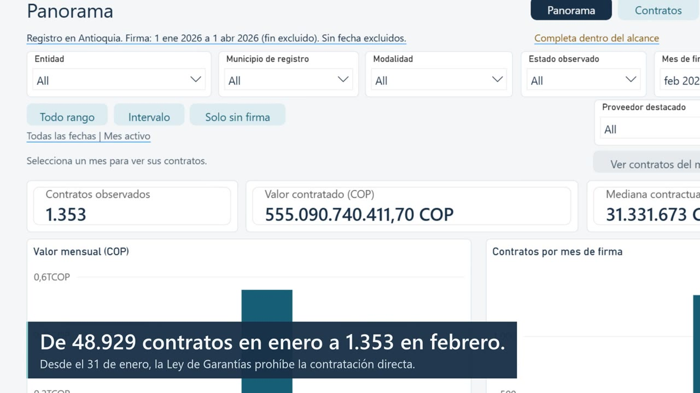
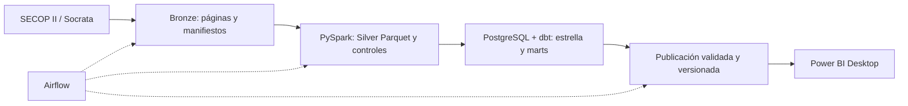
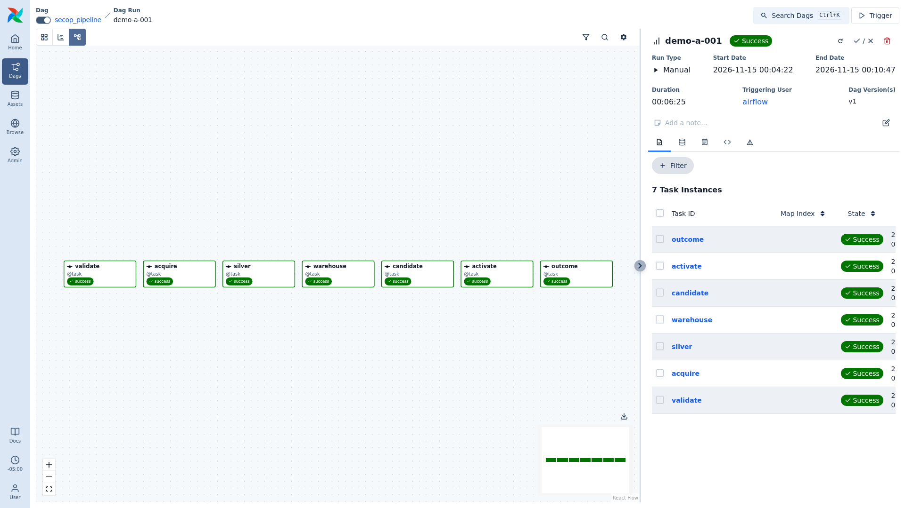
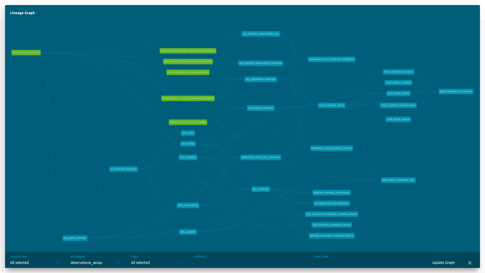
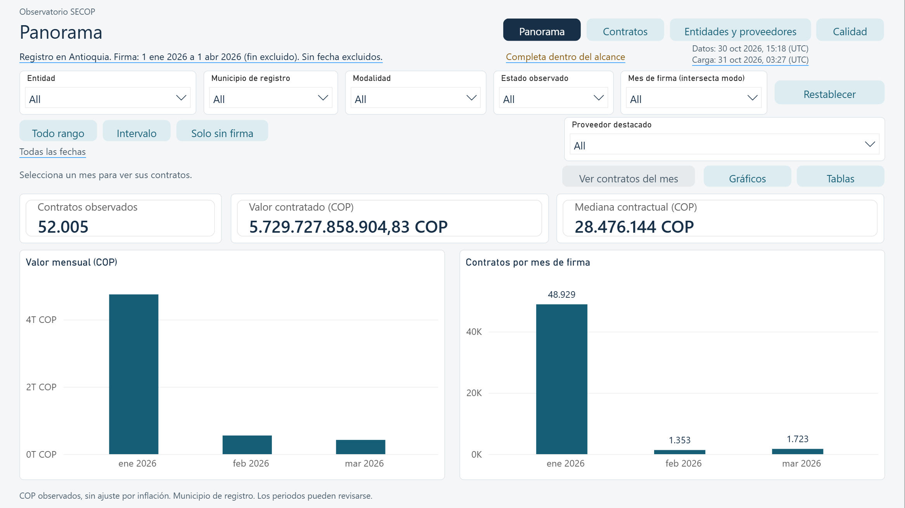
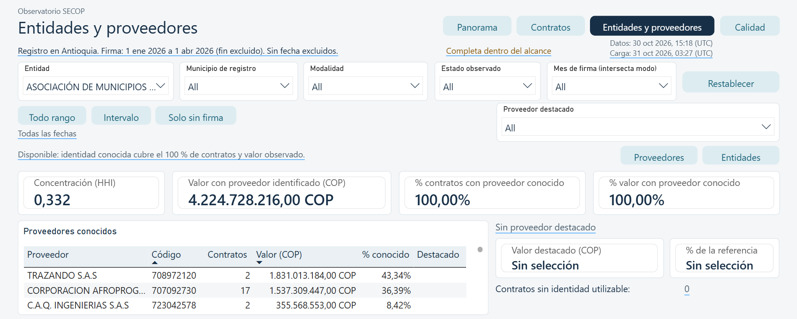
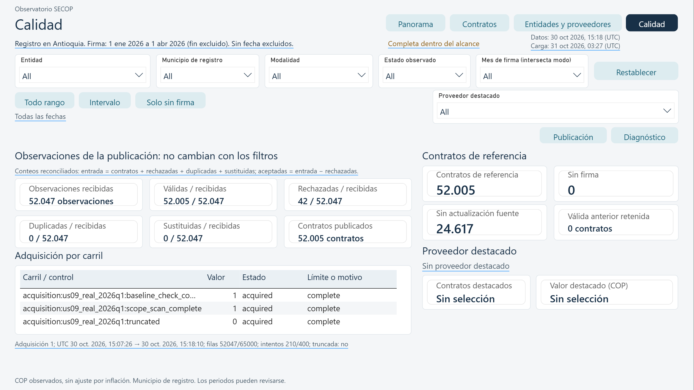

# Observatorio SECOP

[](https://github.com/camiloandcu/observatorio-secop/actions/workflows/ci.yml)


Pipeline de ingeniería de datos que convierte los contratos públicos de SECOP II en analítica confiable: **quién contrata con quién, por cuánto y con qué concentración**, con cada cifra trazable hasta el registro fuente.

Vídeo de un minuto con recorrido por todo el Observatorio SECOP:

[](https://www.youtube.com/watch?v=ckV1dTVN3xw)

> **In English:** An end-to-end data engineering pipeline over Colombia's public procurement records (SECOP II). PySpark ingests and validates 52,047 source observations, PostgreSQL + dbt model a star schema and five governed marts, Airflow orchestrates, and Power BI explores versioned, validated publications. The dashboard reconciles exactly with SQL; failed loads never replace the last good publication. Built by **Camilo Cuellar**, [LinkedIn](https://www.linkedin.com/in/camiloandcu/).

## Lo que muestran los datos

Primer trimestre de 2026, entidades registradas en Antioquia: **52.005 contratos, 5,7 billones de COP**. El 94 % se firmó en enero.

| Modalidad | Enero | Febrero | Marzo |
|---|---:|---:|---:|
| Contratación directa | 45.839 | 173 | 178 |
| Mínima cuantía | 150 | 526 | 762 |
| Total | 48.929 | 1.353 | 1.723 |

La caída no es un error del pipeline. La [Ley de Garantías](https://www.vanguardia.com/politica/2026/01/27/ley-de-garantias-electorales-estas-son-las-restricciones-que-empiezan-a-regir-desde-el-31-de-enero/) prohíbe la contratación directa desde el 31 de enero de 2026, cuatro meses antes de la elección presidencial. Los datos muestran la carrera: **4.767 contratos directos firmados el 30 de enero y 3 el 1 de febrero**, mientras las modalidades competitivas crecen.

## Qué demuestra este producto

| Problema | Cómo se resuelve | Evidencia |
|---|---|---|
| La API pública cambia y no ofrece snapshots | Cada página descargada se guarda con manifiesto y hash; la adquisición tiene límites de filas y solicitudes, checkpoints y reanudación | 52.047 observaciones, escaneo completo, sin truncar |
| Los datos fuente traen duplicados y fechas incoherentes | PySpark tipifica, deduplica y separa rechazos con su motivo | 0 duplicados, 42 rechazos por fechas fuera de orden |
| Un cálculo de dinero mal hecho invalida todo | dbt construye un modelo estrella y cinco marts con dinero decimal y linaje hasta la observación fuente | 17 modelos dbt, 11 tests singulares además de los de esquema |
| Una carga fallida no debe romper el dashboard | Cada publicación se construye y valida aislada antes de activarse; los lectores quedan fijados a una versión | Restaurar una versión anterior es un comando |
| El dashboard debe decir lo mismo que la base | Power BI importa una publicación identificada y se concilia contra SQL | Conteos, COP exactos, mediana y filtros combinados coinciden |
| Saber que todo sigue funcionando | CI con PostgreSQL desechable y Java 17, controles de seguridad y de dependencias | 506 tests en 96 archivos |

También se desplegó una prueba en **AWS (S3 + Glue + Athena)**: Parquet particionado por mes, catálogo en Glue y consulta en Athena que solo lee la partición pedida (13.748 bytes en 787 ms) y concilia conteo y suma con el warehouse. El bucket, los datos y el workgroup se eliminaron después para no generar costos; la prueba aparece en el vídeo.

## Arquitectura



| Ejecución en Airflow | Lineage dbt con tests de conciliación |
|---|---|
| [](docs/images/airflow-run.png) | [](docs/images/dbt-lineage.png) |

La ejecución de la captura usa el fixture sintético de la [guía del pipeline](docs/guias/04_pipeline.md); el lineage corresponde al proyecto dbt del repositorio.

## Decisiones y trade-offs

- **¿PySpark para 52 mil filas?** Para un trimestre de Antioquia bastarían pandas o DuckDB. Spark se eligió porque la misma transformación debe escalar a SECOP nacional, con millones de registros, sin reescribirse. Corre en local para mantener el costo en cero.
- **PostgreSQL + dbt en vez de un warehouse cloud.** Reproducible en cualquier máquina con Docker y sin cuenta de pago; la prueba en AWS muestra el camino hacia un lago de datos consultable con SQL.
- **Publicaciones versionadas en vez de escribir sobre las tablas que lee el dashboard.** Cuesta gestionar versiones, retención y compatibilidad, pero ningún consumidor ve un resultado que todavía no pasó sus tests.
- **Power BI Desktop sin servicio publicado.** Evita licencias y datos expuestos; a cambio, el reporte se comparte como capturas, PDF y vídeo.

## Ver el reporte

| Panorama | Concentración por entidad | Calidad |
|---|---|---|
| [](docs/images/dashboard/real/01-panorama.png) | [](docs/images/dashboard/real/02-entidad-concentracion.png) | [](docs/images/dashboard/real/03-calidad.png) |

Capturas con datos reales de SECOP II (observados el 30 de octubre de 2026). **[Descarga el reporte completo en PDF](docs/report/observatorio-secop-antioquia-2026q1.pdf)** (4 páginas: panorama, contratos, entidades y proveedores, calidad). La [guía del dashboard](docs/guias/05_dashboard.md) explica cómo leer HHI, cobertura y evidencia de cada contrato.

## Ejecutar y verificar

```bash
make install    # dependencias con uv
make quality    # lint, tipos y tests (omite integración sin base de datos)
make ci         # suite estricta: PostgreSQL desechable y Java 17
```

Empieza con la [preparación local](docs/guias/01_inicio.md) y sigue la [guía del pipeline](docs/guias/04_pipeline.md) para ejecutar el flujo en Airflow. La [documentación](docs/README.md) reúne operación, recuperación y referencias por capa.

## Estado

Hecho: adquisición, Silver, warehouse, publicación versionada, orquestación y dashboard. En desarrollo: modelo de priorización con ML y API FastAPI. Los montos son valores contractuales en COP nominales, no pagos, y una señal de revisión no implica irregularidad. Detalle en [alcance y límites](docs/README.md#alcance-y-límites).

Avance en [Issues](https://github.com/camiloandcu/observatorio-secop/issues) y en el [tablero del proyecto](https://github.com/users/camiloandcu/projects/1).

---

**Camilo Cuellar**, ingeniero de datos. ¿Hablamos? [LinkedIn](https://www.linkedin.com/in/camiloandcu/)
