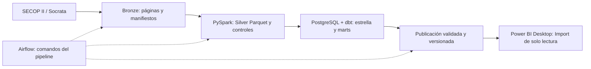

# Documentación

Elige una tarea. Ejecuta los comandos desde la raíz del repositorio; los datos, credenciales y proyectos Power BI permanecen locales.

| Necesito… | Guía |
|---|---|
| Preparar el entorno y comprobar servicios | [Inicio](guias/01_inicio.md) |
| Cambiar código o reproducir CI | [Desarrollo y verificación](guias/02_desarrollo_y_verificacion.md) |
| Diagnosticar servicios y recuperar su estado | [Operación](guias/03_operacion.md) |
| Ejecutar, reintentar o restaurar el flujo Airflow | [Pipeline](guias/04_pipeline.md) |
| Explorar contratos y entender indicadores | [Dashboard](guias/05_dashboard.md) |
| Exportar una publicación a un paquete privado verificable | [Exportación local](guias/09_exportacion_local.md) |

## Arquitectura implementada

Bronze conserva la evidencia recibida. Silver verifica tipos, identidad, población y calidad; el warehouse verifica el bundle antes de conectar. La publicación se construye y valida en aislamiento antes de activarse. Un lector fija una publicación para evitar mezclar versiones entre consultas. La recuperación conserva versiones e identidades explícitas.

Priorización/ML, API y exportación AWS siguen pendientes; los servicios opcionales y sus dependencias instaladas no demuestran esas capacidades. El reporte funciona en Desktop; no se ofrece un enlace interactivo público.

## Referencias por frontera

| Referencia | Contenido |
|---|---|
| [Adquisición y transformación](referencia/01_adquisicion_y_transformacion.md) | Bronze, checkpoints, Silver, rechazos y recuperación |
| [Warehouse y métricas](referencia/02_warehouse_y_metricas.md) | Inventario, carga transaccional, dbt, granos y filtros |
| [Publicación](referencia/03_publicacion.md) | Construcción, activación, lectores fijados, retención y permisos |
| [Identidad](referencia/04_identidad.md) | Códigos, desconocidos, migración y recarga acotada |
| [Población y recuperación](referencia/05_poblacion_y_recuperacion.md) | Cobertura por firma, presupuestos, adopción y restauración |
| [Dependencias](referencia/06_dependencias.md) | Compatibilidad, ensayos y recuperación de servicios |
| [Perfil de la fuente](data-source-profile.md) | Observación fechada, esquema y limitaciones; reporte generado |

La [construcción BI](../bi/README.md), las [medidas](../bi/measures/README.md) y el [proyecto dbt](../dbt/README.md) conservan sus instrucciones junto al código.
