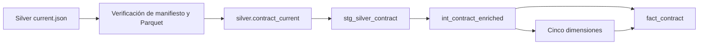

# Modelo estrella de contratos

## Propósito y límites

El modelo estrella ofrece una vista estable y trazable de los contratos vigentes en Silver. PostgreSQL mantiene el snapshot relacional y dbt construye una tabla de hechos y cinco dimensiones para consultas consistentes.

Esta capa no calcula indicadores, agregaciones Gold, puntuaciones ni lógica para Power BI. La carga normal recibe una versión Silver verificada y no consulta Socrata ni Bronze. La adopción histórica explícita también verifica el cierre Bronze retenido.

## Flujo



`secop-warehouse` acepta un bundle fijado con `--version` y `--manifest-sha256`, o fija una vez la identidad señalada por `<SILVER_ROOT>/current.json`, por defecto `data/silver/secop_contracts/current.json`. Las nuevas activaciones requieren una población completa con alcance verificado; las vistas previas se rechazan. Consulta [cobertura y recuperación](population-recovery.md) para adopción histórica y restauración explícita. Antes de conectarse a PostgreSQL comprueba:

- que el puntero resuelva exactamente `versions/<silver_version_id>/manifest.json`;
- hash del manifiesto, estado `valid` y ausencia de controles críticos fallidos;
- existencia, tamaño y SHA-256 de cada archivo inventariado;
- igualdad exacta entre los Parquet de `data/` y el inventario verificado, sin omitir archivos ocultos ni particiones;
- esquema y tipos exactos tras la normalización temporal sin pérdida descrita abajo;
- conteo declarado, una fila por `contract_key` e identificadores obligatorios.

Una falla termina antes de modificar la base.

## Archivos verificados y auxiliares

La verificación completa y la lectura de Silver terminan antes de abrir conexión a PostgreSQL. El lector recibe una lista explícita y ordenada de Parquet verificados; no vuelve a descubrir archivos desde el directorio. Un Parquet adicional se rechaza aunque tenga esquema, versión, llaves y conteo total coherentes. Los archivos de `rejected/`, calidad y otros directorios no aportan contratos; todo archivo declarado sigue sujeto a tamaño y SHA-256.

Las rutas del inventario deben ser relativas al bundle y canónicas con separadores `/`. Se rechazan rutas absolutas, separadores invertidos, componentes vacíos, `.` o `..`, separadores redundantes, duplicados y archivos ausentes o no regulares. No se admiten enlaces simbólicos en las rutas inventariadas ni dentro de `data/`, incluidos directorios y enlaces rotos. La raíz configurada puede ser un alias del filesystem, pero eso no permite enlaces internos en el bundle.

La política se aplica en cada nivel de `data/`, sin excepciones por nombres ocultos o prefijos `_`:

| Archivo | Regla |
|---|---|
| Nombre terminado en `.parquet` | Es dato; debe estar inventariado y verificado, incluso si comienza con `.` o `_` |
| `_SUCCESS` | Es opcional; si existe debe estar inventariado y verificado; no se interpreta como dato |
| `.<nombre-del-archivo>.crc` | Puede omitirse del inventario si acompaña un Parquet o `_SUCCESS` inventariado en el mismo directorio; si se declara se verifica; no sustituye SHA-256 ni se interpreta como dato |
| Cualquier otro archivo | Se rechaza, incluidos `_metadata`, `_common_metadata`, archivos ocultos arbitrarios y sidecars huérfanos |

Debe existir al menos un Parquet de datos. Las particiones Hive reconstruyen `signing_year` como texto, incluido `unknown`; el cambio no altera la compatibilidad temporal. Los archivos publicados deben permanecer inmutables durante verificación y lectura. Los hashes comprueban integridad respecto del manifiesto; no autentican su autor ni protegen contra reescrituras concurrentes hostiles del filesystem.

## Configuración local

Instala el entorno y prepara un perfil dbt local:

```bash
make install
cp .env.example .env                 # solo la primera vez; ajusta valores locales
mkdir -p .dbt
cp dbt/profiles.yml.example .dbt/profiles.yml
```

El perfil usa `POSTGRES_HOST`, `POSTGRES_PORT`, `POSTGRES_DB`, `POSTGRES_USER`, `POSTGRES_PASSWORD`, `DBT_SCHEMA` y `DBT_THREADS`. `POSTGRES_HOST` es opcional y toma `127.0.0.1`. El cargador también usa `SILVER_ROOT`. `.env`, `.dbt/`, `dbt/target/` y `dbt/logs/` están ignorados.

Silver y warehouse comparten la raíz de ejemplo `data/silver/secop_contracts`. El `SILVER_ROOT` exportado prevalece sobre el `silver_root` de cada YAML; un override vacío falla. Sin override se usa el archivo elegido con `--config`, situado antes del subcomando, por ejemplo `secop-warehouse --config config/warehouse.yaml verify`. Las rutas relativas parten del directorio de trabajo; usa la raíz del repositorio. Compose puede leer `.env` sin exportarlo a los comandos Python.

Exporta el archivo solo en la shell que ejecutará el cargador y dbt:

```bash
set -a
source .env
set +a
```

No copies credenciales en `profiles.yml.example`, comandos, issues o logs.

## Compatibilidad temporal y bundles anteriores

La salida nueva de Spark usa microsegundos. El lector acepta únicamente las dos columnas temporales `source_updated_at` y `bronze_fetched_at_utc` en microsegundos o nanosegundos, sin zona o con etiqueta literal UTC. Las convierte en memoria a `timestamp[us]` sin zona solo cuando son exactas. El resto del esquema sigue validándose estrictamente.

En PostgreSQL, `source_updated_at` conserva el reloj fuente de zona desconocida y `bronze_fetched_at_utc` almacena UTC por convención en una columna `timestamp`. No se aplica desplazamiento a Bogotá ni a la zona de la shell. Los nulos opcionales se conservan.

Los bundles INT96 anteriores se consumen desde su raíz original sin reescribir Parquet, manifiestos, punteros ni hashes. Se comprueba que la lectura no pierda submicrosegundos ni desborde el rango de nanosegundos del lector legacy; un valor fuera de ese rango se rechaza explícitamente. Los Parquet nuevos de microsegundos no heredan esa restricción. Otras zonas, unidades, tipos o conversiones con pérdida fallan antes de abrir conexión de base de datos.

Para un `.env` previo no se mueve nada automáticamente: comprueba dónde existe `current.json`, exporta esa raíz para ambas etapas y verifica antes de cargar:

```bash
export SILVER_ROOT=/ruta/a/la/raiz/silver/existente
uv run --locked --extra warehouse secop-warehouse verify
make load-warehouse
```

Si el lector rechaza precisión o rango, conserva la evidencia original y revisa el error; no edites el manifiesto ni fuerces truncamiento. Puedes reconstruir desde Bronze con el escritor nuevo en otra raíz explícita y verificar el resultado antes de cargarlo.

## Carga Silver → PostgreSQL

Inicia PostgreSQL, verifica Silver y carga:

```bash
make up
uv run --locked --extra warehouse secop-warehouse verify
make load-warehouse
```

La carga adquiere un advisory lock y crea una tabla temporal dentro de la transacción. Después:

1. valida filas y llaves en staging;
2. inserta o actualiza por `contract_key` cuando cambian versión, contenido o campos de identidad;
3. elimina llaves ausentes del snapshot Silver autoritativo;
4. registra una identidad nueva en `silver.load_audit` solo en su primera carga;
5. agrega el evento a `silver.load_audit_activation` y actualiza `silver.load_audit_active`;
6. confirma filas, registro, historial y estado activo juntos.

La consulta de estado y la migración también quedan dentro del lock. Repetir la versión y hash **actualmente activos** es un no-op exitoso con conteos de cambio cero. Haber cargado una versión antes no impide restaurarla después de otra: A → B → A aplica A nuevamente y devuelve `applied`. Reutilizar una `silver_version_id` con otro hash falla como conflicto tanto si está activa como si es histórica. Una excepción revierte reconciliación, registro, historial y estado activo.

`load_audit` conserva hash, fecha del manifiesto y conteos de la primera carga de cada versión. `load_audit_activation` registra cada aplicación confirmada, su identidad previa, conteos y tipo `activation` o `restoration`; repetir la versión activa no agrega eventos. `load_audit_active` contiene como máximo una fila y referencia el evento activo. Los eventos se ordenan por `activation_id`; puede haber saltos por transacciones revertidas. `activated_at` indica el momento del evento, mientras `contract_current.loaded_at` sigue siendo la fecha determinística del manifiesto original, incluso al restaurar.

Los nombres de estado e historial se derivan del `audit_table` configurado con sufijos
`_active` y `_activation`; también se crea un índice único `_identity` para las referencias
versión/hash y una tabla `_schema` para la revisión relacional. Todos deben ser distintos
de `contract_table` y caber en 63 bytes; se rechazan nombres que colisionan o se truncarían
antes de conectar. No se necesitan claves YAML nuevas.

Los logs contienen versión, estado y conteos, nunca contraseña ni DSN completo.

## Granularidad e identidad

`fact_contract` tiene una fila por `contract_key`: el contrato vigente que Silver seleccionó de forma determinística. Una corrección histórica actualiza esa fila; este modelo no conserva SCD2.

Las sustitutas de contrato y dimensiones sin código de plataforma usan el `md5` nativo
de PostgreSQL sobre `star_key_v1|<namespace>|<natural_key>`. Las identidades conocidas de
entidad/proveedor tienen una regla independiente, descrita abajo. El hash aporta
estabilidad y portabilidad, no seguridad. Tests comprueban unicidad y correspondencia
entre llave natural y sustituta.

| Modelo | Llave natural | Llave sustituta | Política desconocida |
|---|---|---|---|
| `fact_contract` | `contract_key` | `contract_sk` | No aplica |
| `dim_entity` | dataset + rol + código de entidad | `entity_sk` | `__UNKNOWN__` si el código es desconocido |
| `dim_supplier` | dataset + rol + código de proveedor | `supplier_sk` | `__UNKNOWN__` si el código es desconocido |
| `dim_municipality` | `municipality_key` | `municipality_sk` | `__UNKNOWN__` si Silver marca UNKNOWN |
| `dim_modality` | modalidad normalizada | `modality_sk` | `__UNKNOWN__` si falta modalidad |
| `dim_date` | fecha calendario | entero `YYYYMMDD` | `date_sk=0` |

Silver expone códigos de plataforma, etiquetas y estado/motivo por rol. Los nombres no
definen identidad; un código válido sin nombre sigue conocido. Las sustitutas conocidas
de entidad/proveedor usan `platform_code_key_v1`; contratos y otras dimensiones conservan
`star_key_v1`, al igual que los miembros desconocidos. La migración inicial requiere un
rebuild dbt explícito. Los [detalles de identidad y recuperación](platform-identity.md)
incluyen perfiles Bronze antiguos/nuevos, adaptación Silver y recarga acotada.

## Trazabilidad

`fact_contract` conserva:

- `contract_key`, `contract_id` y `process_id`;
- `source_url`, `source_updated_at` y `bronze_fetched_at_utc`;
- `silver_version_id`, `silver_manifest_sha256` y `payload_sha256`;
- `loaded_at`, tomado de `finished_at_utc` del manifiesto Silver;
- fechas de firma, inicio y terminación junto con sus claves;
- valor contractual, duración y estado fuente.

`loaded_at` no usa la hora de ejecución de dbt. Reconstruir la misma versión conserva el mismo valor lógico.

## Construcción incremental y rebuild

Ejecuta el modelo y todos sus tests:

```bash
make dbt-parse
make dbt-build
make dbt-test
```

Los modelos publicados usan materialización incremental y llaves únicas. Como Silver es un snapshot autoritativo, cada modelo reconcilia su contenido en una transacción antes de insertar la proyección vigente. Esto retira hechos y miembros obsoletos y evita que una carga incremental acumule residuos.

Para reconstruir desde cero:

```bash
make dbt-build DBT_ARGS=--full-refresh
```

Para una misma `silver.contract_current`, incremental y full refresh deben coincidir en columnas, filas, llaves, conteos y hashes canónicos. La suite de integración compara ambos resultados.

## Controles dbt

`dbt build` bloquea el resultado cuando encuentra:

- llaves naturales o sustitutas nulas o duplicadas;
- un contrato repetido o distinto del conjunto fuente;
- relaciones inválidas entre hecho y dimensiones;
- estados distintos de `KNOWN` y `UNKNOWN` en dominios controlados;
- cero o más de un miembro desconocido;
- colisiones entre llaves naturales y sustitutas;
- diferencias de trazabilidad entre Silver y el hecho.

Una ausencia explícita usa el miembro desconocido. Una llave presente que no resuelve no se convierte silenciosamente en desconocida: el test de relación falla.

## Catálogo dbt

Genera y sirve la documentación local:

```bash
make dbt-docs
uv run --locked --extra warehouse dbt docs serve \
  --project-dir dbt --profiles-dir .dbt --host 127.0.0.1 --port 8081
```

`dbt/target/` contiene el catálogo generado y permanece fuera de Git. Cada source, modelo y columna declara descripción, identidad, nulidad y procedencia.

## Diagnóstico y recuperación

### Silver no verifica

Ejecuta `secop-silver inspect` y revisa el manifiesto publicado. No edites un bundle inmutable. Corrige la causa en Bronze/Silver o vuelve mediante el comando soportado a una versión Silver válida.

Si el error identifica un archivo extra, ausente, alterado, una ruta inválida o un auxiliar no soportado, conserva el bundle y el diagnóstico. No actualices el manifiesto/hash ni borres archivos para forzar aceptación. Selecciona una versión íntegra retenida y sigue la secuencia de verificación/carga descrita abajo, o reconstruye desde Bronze en otra raíz explícita. El rechazo de inventario no abre conexión PostgreSQL y conserva las filas y los metadatos activos; cambiar solo el puntero Silver tampoco los modifica.

### La carga PostgreSQL falla

La transacción conserva el snapshot anterior. Corrige conexión, espacio o conflicto y repite `make load-warehouse`; no limpies tablas manualmente.

### Un test dbt falla

El mensaje identifica modelo, columna o relación. Las tablas siguen consultables para diagnóstico, pero el build no es válido. Corrige la fuente o modelo y repite `make dbt-build`. Usa `--full-refresh` si cambió el esquema físico.

### Volver a una versión Silver anterior

Conserva los bundles inmutables de A y B y prueba primero contra una base desechable dedicada. Sigue los comandos fijados de [restauración compatible](population-recovery.md#cargar-adoptar-y-restaurar): cada almacén exige destino registrado, alcance compatible e identidad actual esperada. La secuencia A→B→A recupera los datos originales y conserva el alcance persistente; una repetición exacta de A es no-op.

Cambiar el puntero Silver no carga PostgreSQL. `verify` valida el bundle sin modificar la base. Si usas YAML propio, conserva el mismo `--config` antes de `verify`/`load` en cada invocación; `make load-warehouse` usa el YAML de ejemplo.

En tu cliente PostgreSQL, ejecuta estas consultas después de cargar A por primera vez y tras restaurarlo. Usa la misma zona UTC para estabilizar la representación temporal. Los nombres corresponden al YAML de ejemplo:

```sql
SET TIME ZONE 'UTC';
SELECT count(*) AS contracts, sum(contract_value_cop) AS value_cop,
       md5(string_agg(row_to_json(c)::text, E'\n' ORDER BY contract_key)) AS content_digest
FROM silver.contract_current c;
SELECT contract_key, contract_value_cop, silver_version_id,
       silver_manifest_sha256, bronze_run_id, loaded_at
FROM silver.contract_current ORDER BY contract_key;
SELECT * FROM silver.load_audit_active;
SELECT activation_id, silver_version_id, manifest_sha256,
       previous_version_id, event_kind, source_rows,
       inserted_rows, updated_rows, deleted_rows
FROM silver.load_audit_activation ORDER BY activation_id;
SELECT * FROM silver.load_audit ORDER BY silver_version_id;
```

Conteo, suma decimal y digest de todas las columnas deben ser iguales a los de A inicial; la identidad activa debe ser A. En una base nueva, el historial será A/B/A, con el último evento `restoration`, y el registro conservará solo dos identidades. El segundo intento de A activo debe dejar esas consultas sin cambios. El digest SQL sirve para comparar contenido, no reemplaza el SHA-256 de integridad del bundle; las pruebas automatizadas también comparan todas las columnas y su SHA-256 canónico.

Si la restauración falla, B permanece íntegro junto con su estado e historial. Corrige la causa y repite la carga del bundle A verificado; no borres auditoría ni tablas. Solo después de restaurar PostgreSQL reconstruye los modelos dimensionales:

```bash
make dbt-build
```

### Migrar una auditoría existente

Antes de actualizar el cargador, detén los escritores anteriores y respalda las tablas actuales, la auditoría y los bundles Silver retenidos. No mezcles versiones de escritores. La primera carga con el nuevo código migra dentro de su transacción y lock, sin cambiar ningún valor de las filas históricas de `load_audit`.

Si las filas actuales tienen una sola versión/hash/`loaded_at` y coinciden con identidad, fecha del manifiesto y conteo auditados, se agrega un único evento `legacy_baseline`. Es una inferencia del estado observado al migrar, no una reconstrucción del historial pasado: no inventa conteos de cambio y no escoge la versión por `attempted_at`. Después se aplica la solicitud o se devuelve no-op si ya está activa. Repetir la migración no duplica ese evento ni reinicia el estado.

Con tablas actuales vacías no se infiere una versión activa desde la auditoría histórica: la solicitud verificada se aplica para establecer estado conocido. Si hay versiones/hashes mezclados, registro ausente, conteos/fechas incompatibles o metadatos parcialmente presentes, la carga falla sin confirmar cambios. Conserva el error y los respaldos; inspecciona las identidades y conteos con las consultas anteriores. Recupera el bundle elegido en un schema nuevo mediante un YAML separado y las mismas órdenes `verify`/`load`; valida el resultado antes de cambiar consumidores. No elimines evidencia ni repares los registros para forzar la migración.

Un fallo de migración revierte automáticamente sus cambios. Para volver a un binario anterior, detén escritores y recupera un respaldo coherente previo en otra base/schema bajo control del operador; conserva la evidencia nueva. El cargador antiguo no entiende activaciones y no sirve como procedimiento de restauración A → B → A.

## Analítica Gold

Los cinco marts y las consultas gobernadas se describen en [indicadores Gold](gold-analytics.md). Conservan snapshot/scope y evidencia verificada de calidad; la publicación y los permisos de consumidores requieren el mecanismo de activación posterior.
